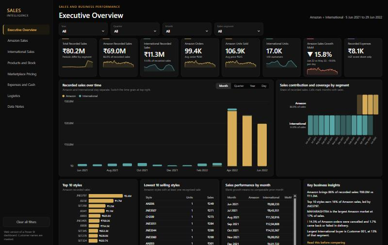
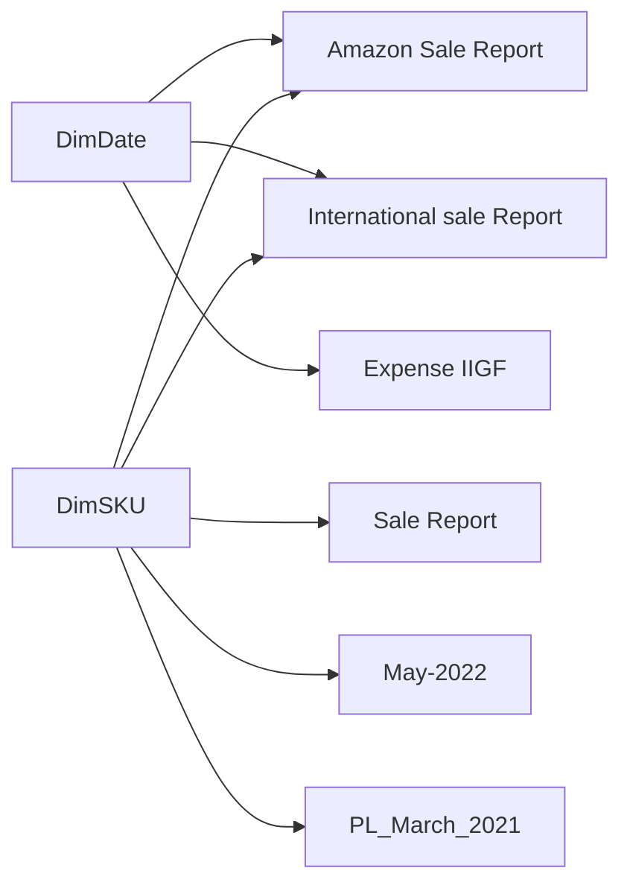

# Enterprise Sales and Business Performance Intelligence

An eight-page Power BI report that turns fragmented retail data (marketplace orders, an export ledger, stock, price lists, a cash sheet and a logistics rate card) into one decision-oriented dashboard.

**Stack:** Power BI Desktop (PBIP, TMDL, PBIR), Power Query (M), DAX, Deneb (Vega-Lite), custom JSON theme, SVG generated from DAX, Python for profiling and report generation.

**Live demo:** [open the dashboard](https://surja2003.github.io/Enterprise-Business-Intelligence-Sales-Analytics-Dashboard/) (web version with clickable pages, no Power BI needed)

## Web version

The `docs` folder is a static copy of the report for GitHub Pages. Every figure is exported from the Power BI model by `tools/export_site_data.ps1` and `tools/build_site.py`.

- International customer names are masked as Customer 001, 002 and so on, and personal names on the expense sheet are removed
- It filters by year, quarter and month, not by exact date range
- Clicking a bar does not filter the other charts, as it does in Power BI
- SKU Detail opens for SKUs in the Top 15 and Top 10 lists

## Business problem

Management needs to know what was sold, where, through which segment and which products carry the business. The source files cover different periods and grains, and several contain structural errors. The real work was making the numbers defensible first, then presenting them.

## Key findings

| Finding | Evidence |
|---|---|
| Amazon brings 86% of recorded sales | ₹69.0M against ₹11.3M |
| Sales are not concentrated in a few styles | Top 10 styles earn 16% of Amazon sales |
| Maharashtra is the largest Amazon market | 17% of Amazon sales |
| Amazon sales fell two months running | May -8.6%, June -15.8%. Per trading day, because months differ in length: -11.5% and -10.0% (June data ends on the 29th) |
| Cancellations are the largest visible leak | 14.3% of orders, ₹6.9M of recorded value. 7,566 cancelled lines have no Amount, so the true value is higher |
| International depends on a few buyers | The largest customer is 13% of the segment, the top 10 of 149 are 43% |
| 266 of 1,330 products have marketplace price gaps | Average gap ₹188, maximum ₹800 |

## Data quality issues found and fixed

These were found by profiling the raw CSVs against the loaded model. Each result was reconciled to an independent pandas calculation.

| Dataset | Issue | Effect before | After |
|---|---|---|---|
| International | File stacks several exports. 17,756 rows have shifted columns | Customer names in `DATE`, rates in `PCS`, 14.6M "units", 64 "customers" including values like `Jun-21` | 16,958 units, 149 customers |
| International | Date was text and no row matched `DimDate` | International ignored every date filter, and growth was blank | All rows matched |
| International | A leftover filter dropped every row where the amount reconciled | Valid transactions lost | Filter removed |
| International | 5,696 rows repeat earlier rows exactly (index 10196-15891) | Would double count Oct 2021 to Mar 2022 | Exact range removed, genuine repeat lines kept |
| Amazon | Non-shipped orders were filtered out in Power Query | Cancellations showed as zero | All 128,975 rows loaded, policy applied in measures |
| Expense | A subtotal row and a balancing row were summed as expenses | ₹13,095 | ₹8,095 |
| Amazon | State spelling variants (RJ, RAJSTHAN, ORISSA and others) | Split rankings | `State Clean` column, original kept |
| Report | All pages were flagged as tooltip pages, and insight text was hard-coded | Stale claims, such as "no cancellations" | Regular pages, insights calculated from the data |

## Definitions

| KPI | Definition | Source |
|---|---|---|
| Amazon recorded sales | Sum of `Amount` where status is Shipped or Delivered to Buyer | Amazon Sale Report |
| International recorded sales | Sum of original `GROSS AMT`. PCS x RATE is kept separately | International sale Report |
| Total recorded sales | The two above. Periods differ and overlap only in Apr to May 2022 | Both |
| Cancelled, returned, in progress | Distinct orders in each status group | Amazon Sale Report |
| Recorded expenses | 13 line items on one event sheet. Not business costs | Expense IIGF |
| Recorded balance difference | Receipts minus expenses. Not profit | Expense IIGF |

**Deliberately not shown:** net profit, gross profit and COGS (no cost data), year-over-year growth (no overlapping periods), stock turnover (one undated snapshot), and price movement between snapshots (the two price files hold identical MRPs).

**Assumption:** International has no currency field. It is shown in rupees because its rates sit in the same range as Amazon prices.

## Data model

Star schema with single-direction filtering from dimensions to facts.

Helper tables `Segment`, `Marketplace` and the `Trend Grain` field parameter have no relationships. The measures read them directly. The May-2022 and March 2021 SKU codes match no sales or stock table, so price and sales are not compared. The ER Wait Time dataset is unrelated and is not loaded.

## Report pages

1. **Executive Overview:** KPIs, trend by day, month, quarter or year, segment contribution, top and lowest styles, calculated insights
2. **Amazon Sales:** order outcomes, fulfilment, B2B, products, category, size, state and city
3. **International Sales:** customers, styles, SKUs and sizes, with limits stated
4. **Products and Stock:** stock against units sold, SKU match coverage
5. **Marketplace Pricing:** MRP by marketplace, coverage, largest price gaps
6. **Expenses and Cash:** receipts, expense ranking, balance
7. **Logistics:** Shiprocket and INCREFF rates, service terms
8. **Data Notes:** definitions, corrections and limitations

Two hidden drill-through pages open from a right-click, then **Drill through**:

- **SKU Detail:** from Top 15 SKUs on Products and Stock, or Top 10 SKUs on International. Shows sales, units, order outcomes, recorded stock, daily sales, and top states and cities for one SKU. A blank stock card means no record, not zero
- **Marketplace Detail:** from Pricing coverage on Marketplace Pricing. Shows one marketplace's MRP against all eight, its price bands, and products where it lists the highest or lowest price. These are list prices, not sales by marketplace

## Technical notes

- 217 DAX measures in `_Measures`, organised into display folders
- KPI cards and the navigation rail are SVG images generated by DAX, so they respond to filters
- `tools/build_model.py` and `tools/build_report.py` regenerate the model fixes and report from one layout system. `tools/_orig` holds the original model definition
- Deneb visuals (Vega-Lite specs in `tools/deneb_specs.py`):
  - Segment coverage strip: sales share and which months each segment has data
  - Daily sales calendar: click a day to filter the page
  - Order value waterfall: recorded value by order outcome
  - Customer concentration curve: ranks only, no customer names
  - MRP range by marketplace: lowest, average and highest
  - Price distribution on Marketplace Detail: products in each MRP band
  - Ranked Top 10 bars on the Executive and Amazon pages, plus Fulfilment and B2B: click a bar to filter
- The report uses the certified Deneb visual from AppSource, so Power BI Desktop needs internet access the first time it loads it

## Run it

1. Put the CSV files in `C:\Data\SalesBI`, or update the paths in the Power Query sources to your own folder.
2. Open `EnterpriseSalesBI.pbip` in Power BI Desktop and select **Refresh**.

Source data is not included in this repository. The Power BI report shows real International customer names once refreshed, so review any screenshots of it before publishing them.
